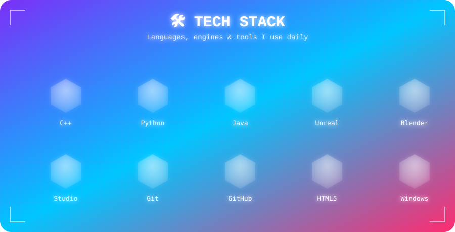
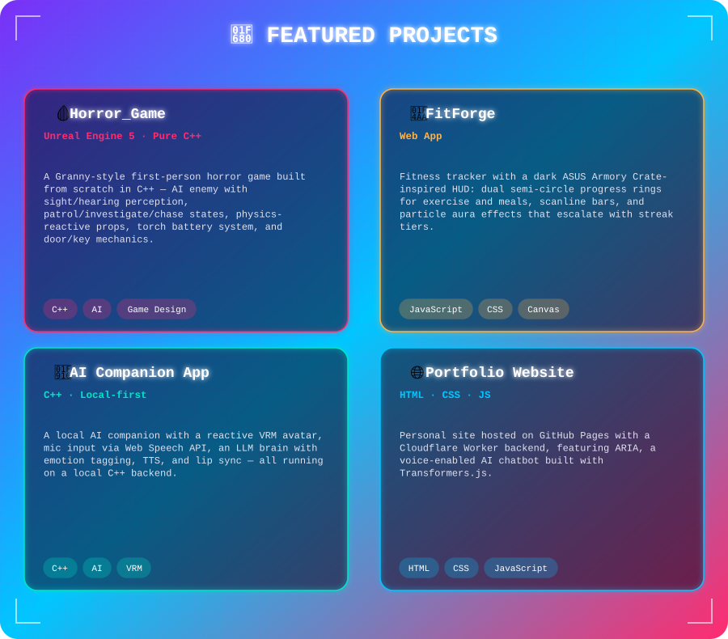
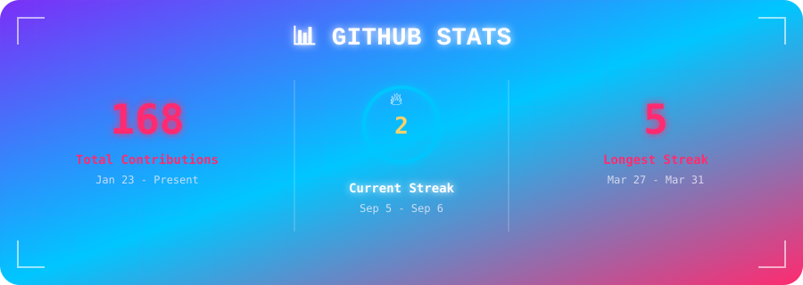
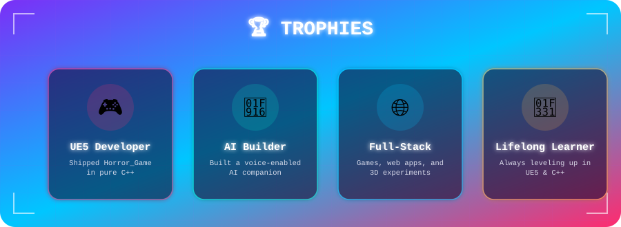
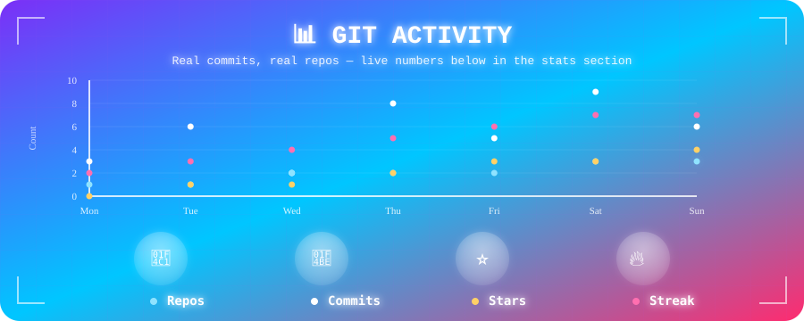
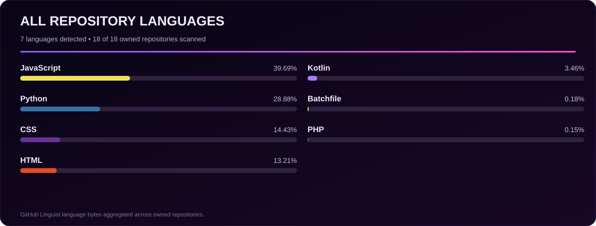
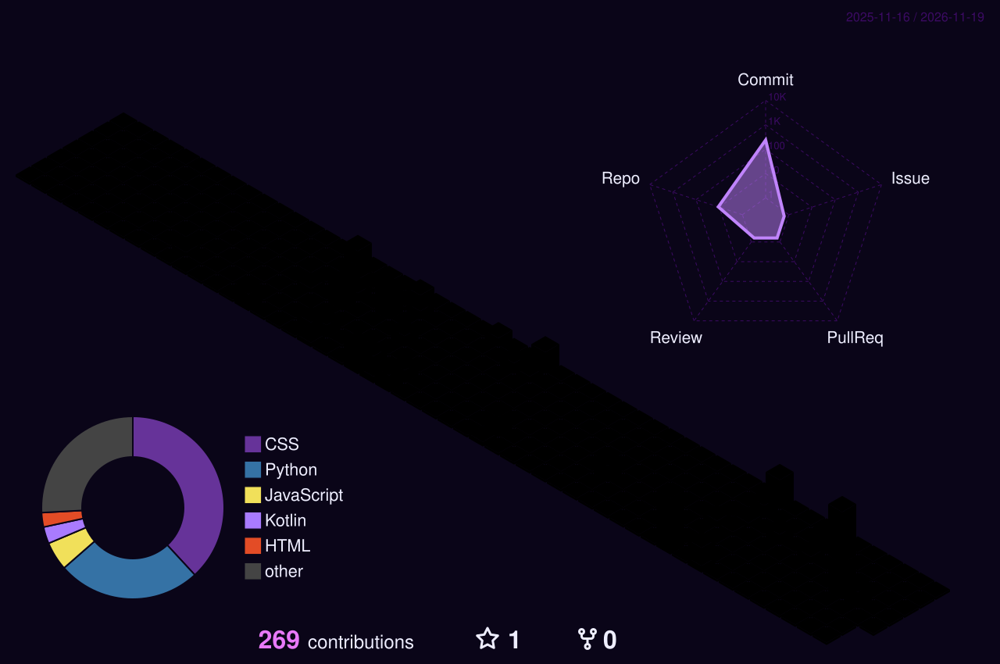

I build immersive 3D experiences and interactive applications. Passionate about **Game Development**, **Real-time Graphics**, and creating impactful projects.

📍 Barnala, Punjab, India &nbsp;|&nbsp; 🎓 BCA Graduate

 

## 👋 About Me

 

## 🛠️ Tech Stack

 

## 🚀 Featured Projects

**[→ See all repos](https://github.com/mohak-mittal?tab=repositories)**

 

## 📊 GitHub Stats

 

## 🏆 Trophies

 

## 🐍 Contribution Snake & 3D Graph

<picture>
  <source media="(prefers-color-scheme: dark)" srcset="https://raw.githubusercontent.com/mohak-mittal/mohak-mittal/output/github-contribution-grid-snake-dark.svg" />
  <source media="(prefers-color-scheme: light)" srcset="https://raw.githubusercontent.com/mohak-mittal/mohak-mittal/output/github-contribution-grid-snake.svg" />
  
</picture>

  

  

  

 

## 💭 What I Believe

### ⚡ *"Talk is cheap. Show me the code."*
**— Linus Torvalds**

 

> 🎮 **Great games are not made, they are survived.**
> Every bug, every crash, every 3 AM rebuild is part of the craft.

> 🧠 **Skill is built in the hours nobody claps for.**
> Discipline beats talent the day talent stops showing up.

> 🔥 **I don't wait for permission to build.**
> One person, one machine, one idea is enough to start a studio.

> 🕹️ **Make it work. Make it right. Make it fast.**
> — Kent Beck

> 🌌 **Code isn't just about syntax. It's about solving real problems and building something people actually love using.**

 

**Build bold. Ship often. Never stop leveling up.** 🚀

 

## 📫 Let's Connect

I'm always open to collaboration, freelance work, or just talking shop about game dev and C++.

 

<i>Thanks for visiting! ⭐</i>

